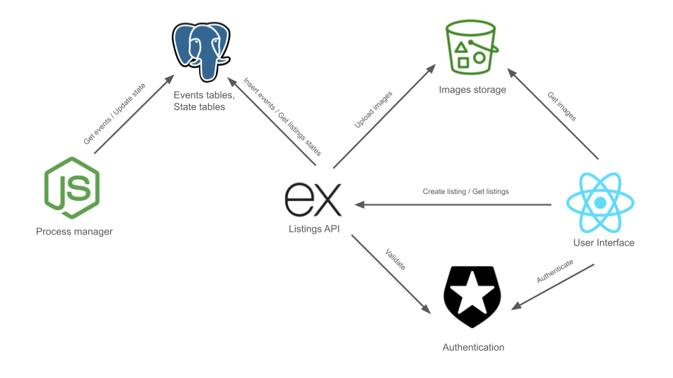
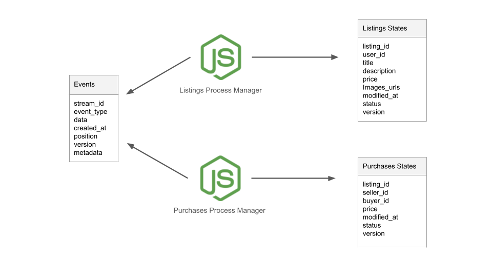
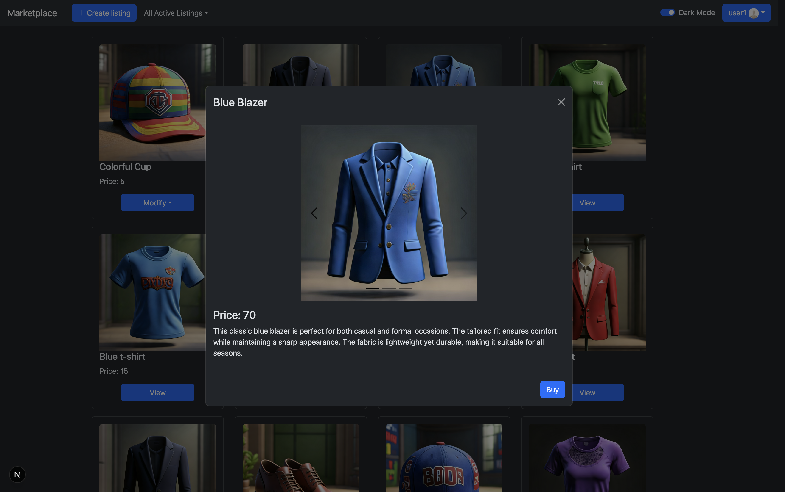
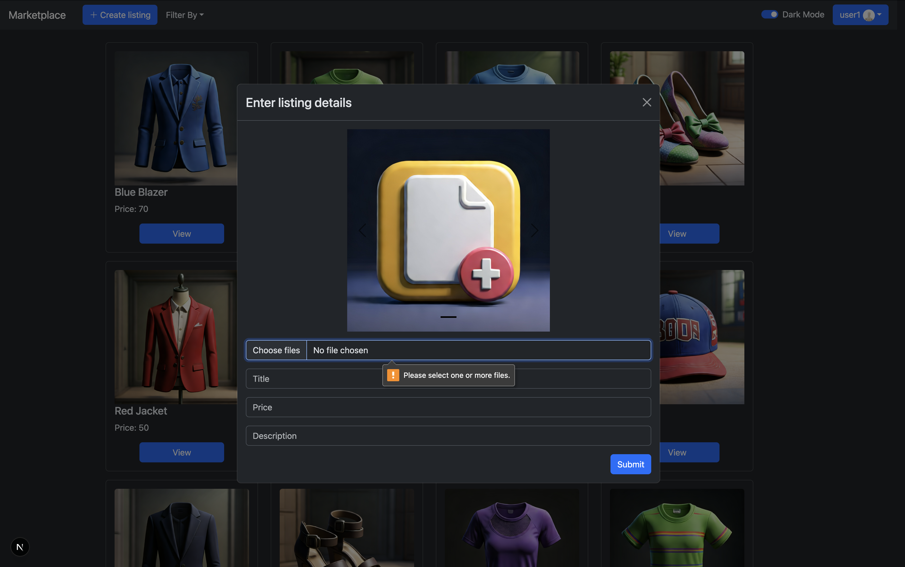
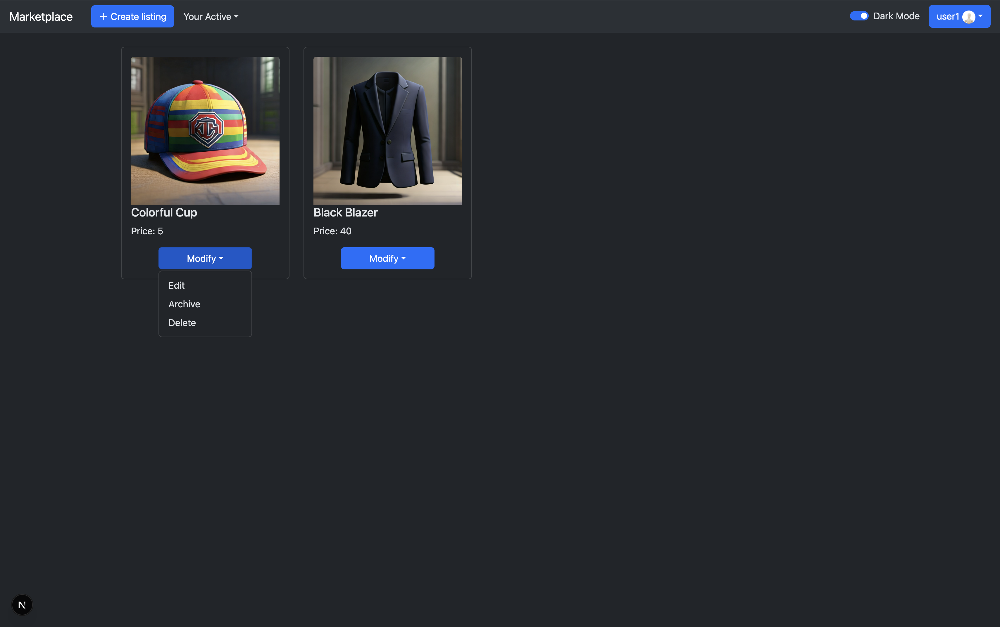
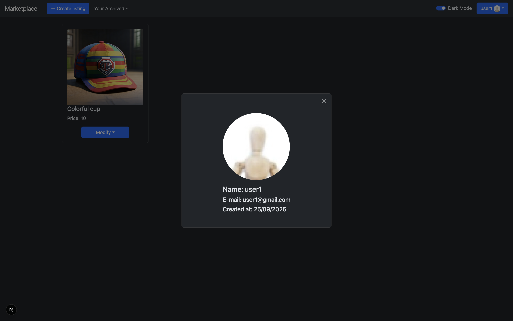

# Marketplace (in development)

## Abstract

This repository contains the source code for the Marketplace application, a platform that enables users to list their own items for sale and purchase items from others, similar in concept to Facebook Marketplace. The application is built using an event-sourcing architecture.

## Technlogies

- Typescript - programming language
- ExpressJS - API application framework
- React - UI Framework
- Bootstrap - CSS framework
- Auth0 - authentication
- Stripe - payments
- AWS S3 Bucket - storage
- Postgres - database
- Docker Compose - runtime


## Description

This document is divided into several sections. The current section provides an overview of the project, including the services developed to support the application and the technologies used. Following this, you will find a Tutorial explaining how to use the application. Below the tutorial, the Requirements section outlines the necessary tools, and finally, the Installation section guides you through the setup process.

### Services overview

User interaction is handled through a website developed using React, with React Bootstrap serving as the dedicated CSS framework for styling. The data displayed on the website is retrieved from an API service built with Node.js and Express.js. For persistence, the application uses a PostgreSQL database, while an S3 bucket is employed for storing images. The diagram below illustrates the services that were implemented to build this application.



### Event Sourcing architecture

The application is built using an Event Sourcing architecture pattern. Users can purchase items listed in the Marketplace, as well as create, update, archive, restore, and delete their own listings. Each of these actions generates an event that is stored in the event store table.

Process managers operate as separate applications responsible for handling these events and updating the states table based on the event type. This approach provides a complete history of user activity and listing changes.

The sample `LISTING_CREATED` events in `db-init.sql` use the `userId` field
expected by the listing projection and assign the demo listings to Marketplace
user `748f3744-8636-48a6-9eaa-fb79519b07f9`. The init script is only run when
PostgreSQL initializes an empty data directory. To reassign existing listings
and normalize their event payloads, run the migration from the repository root:

```
docker compose exec -T db psql -U default_user -d marketplace < db-migrations/20261103_assign_listings_to_user1.sql
```

The migration requires that user1 already exists in `states.users`. It updates
listing creation events and their current projection, but leaves historical
purchase seller records unchanged.

The diagram below illustrates the database tables created for this application.



## Tutorial

How to use this application? It is very simple. Main page looks like:


### Login

You can browse and view listings without logging in. However, logging in allows you to purchase items and create your own listings. Click the Login button, and you will be redirected to the Auth0 page, where you will need to create an account. On the first authenticated request, the Users API verifies the account with Auth0 and provisions the local user record through the event stream. After successful authentication, you will be redirected back to the Marketplace, where you should see a dashboard similar to the example below.

Notice that the Login to add listing button has been replaced by the _+ Create Listing_ button, and next to it, you will find a _Filter By_ dropdown. On the far right of the navigation bar, the Login button is replaced by your account nickname and profile photo.


### View and buy listing

On the main page, each listing shows only one photo along with the item’s name and price. To view more details, you can click the View button, which will open the full listing and display the description. If the listing contains multiple photos, a carousel will automatically rotate through them every few seconds.

When you want to purchase an item, simply press the Buy button and it will be added to your purchases. You can review all the items you have bought by setting the Filter By option to Your Purchases.



### Add your listing

You can add a new item by pressing the + Create Listing button. To complete the process, you must upload at least one photo, set a price, and provide both a title and a description for the listing. For form validation project uses [Formik](https://formik.org/) module. Once your listing is added, it will appear on the main page alongside other listings. However, instead of displaying a View button like the others, your listings will feature a Modify button, allowing you to edit them at any time.



### Modify your listings

To view listings available for purchase, set the Filter By option to Your Active. You can modify the details of an existing listing by selecting Edit from the Listing Modify dropdown menu.

You can also Archive a listing, which makes it invisible to all users except you. This allows you the option to restore the listing at a later time. Alternatively, you may choose to Delete a listing permanently.



### Filter and switchin beetween dark and light mode

All available application filters are presented here, along with the option to activate the light theme.


### Account details

To view your account details, click the button featuring your nickname, which is located on the right side of the navigation bar.



## Requirements

- Docker with the Compose plugin
- Node.js 24 and npm for the frontend
- An Auth0 tenant
- An AWS S3 bucket and IAM credentials for listing images
- A Stripe account and Sandbox for payment testing

## Installation process

Grafana requires `GRAFANA_ADMIN_PASSWORD` for every Docker Compose command.
Set a local password in the shell where you will run Compose; do not commit it
to the repository:

```bash
export GRAFANA_ADMIN_PASSWORD='choose-a-local-password'
```

### Download the project

Clone the repository or download and unpack the [main branch ZIP](https://github.com/Bartosz95/marketplace/archive/refs/heads/main.zip):

```
git clone https://github.com/Bartosz95/marketplace.git
```

### Configure Auth0

In Auth0, create:

- A **Regular Web Application**. Add `http://localhost` to its Allowed Callback URLs, Allowed Logout URLs, and Allowed Web Origins.
- An **API** with an identifier to use as the audience.
- A **Machine to Machine Application** authorized for the Auth0 Management API with the `read:users` permission. This is used to provision local user records from Auth0 profiles.

Use the tenant domain, API audience, and application credentials in the environment files below. The frontend redirect URI must match the Auth0 callback URL.

### Configure the backend

Create `backend/.env` (the file is git-ignored) and fill in the values for your setup:

```dotenv
# Compose uses these credentials to initialize the local PostgreSQL database.
DB_HOST=localhost
DB_PORT=5432
DB_USER=default_user
DB_PASSWORD=password
DB_NAME=marketplace

APP_LOG_LEVEL=info
APP_LOOP_TIMEOUT=1000

# Auth0 API and tenant
AUTH_AUDIENCE=<Auth0 API identifier>
AUTH_ISSUER_BASE_URL=https://<Auth0 tenant domain>/
AUTH_MANAGEMENT_DOMAIN=<Auth0 tenant domain>
AUTH_MANAGEMENT_CLIENT_ID=<Auth0 machine-to-machine client ID>
AUTH_MANAGEMENT_CLIENT_SECRET=<Auth0 machine-to-machine client secret>

# S3 bucket used to store and serve listing images
AWS_BUCKET_REGION=<AWS region>
AWS_BUCKET_NAME=<bucket name>
AWS_BUCKET_ARN=<bucket ARN>
AWS_BUCKET_ACCESS_KEY=<IAM access key ID>
AWS_BUCKET_SECRET_ACCESS_KEY=<IAM secret access key>
AWS_BUCKET_URL=<public base URL used to serve bucket objects>

# Stripe Sandbox credentials; see Stripe Connect payments below
STRIPE_SECRET_KEY=<Stripe Sandbox secret key>
STRIPE_WEBHOOK_SECRET=<Stripe webhook signing secret>
FRONTEND_URL=http://localhost
```

The Compose file supplies service-specific `APP_NAME`, `APP_PORT`, `APP_HOST`,
and `DB_HOST` values. It maps the gateway to `http://localhost:3000`; the
frontend is run separately below. The AWS IAM credentials need access to list,
upload, and delete objects in the configured bucket. Configure the bucket so
the image URLs in `AWS_BUCKET_URL` can be read by the browser.

### Configure the frontend

Create `frontend/.env`:

```dotenv
NEXT_PUBLIC_API_URL=http://localhost:3000/api/v1
NEXT_PUBLIC_AUTH0_DOMAIN=<Auth0 tenant domain>
NEXT_PUBLIC_AUTH0_CLIENT_ID=<Auth0 Regular Web Application client ID>
NEXT_PUBLIC_AUTH0_AUDIENCE=<Auth0 API identifier>
NEXT_PUBLIC_AUTH0_REDIRECT_URI=http://localhost
```

The names above must match the variables read by the frontend and backend.
Never put Stripe secret keys, webhook signing secrets, AWS credentials, or
Auth0 machine-to-machine credentials in the frontend environment file.

### Stripe Connect payments

Use the same Stripe **Sandbox** for `STRIPE_SECRET_KEY`, the Stripe CLI, and
the test payments. The backend secret key must be a Sandbox secret key
(`sk_test_...`). For the Compose listener, set `STRIPE_API_KEY` in
`backend/.env` to a test-mode API key accepted by the current Stripe CLI. A
restricted key created from Stripe's **Platform and marketplace payments**
template can be used; keep it private. Do not use a live-mode key.

The local listener is included in Compose under the `stripe-local` profile. The
Payment API requires a webhook signing secret on startup, so initially set
`STRIPE_WEBHOOK_SECRET` to a temporary placeholder, then start the services:

```bash
docker compose up --build -d
docker compose --profile stripe-local up -d stripe-cli
docker compose --profile stripe-local logs -f stripe-cli
```

Copy the `whsec_...` signing secret printed by Stripe CLI into
`STRIPE_WEBHOOK_SECRET` in `backend/.env` and recreate the Payment API:

```bash
docker compose up -d --force-recreate payment-api
```

The Compose listener forwards `checkout.session.completed`,
`checkout.session.async_payment_succeeded`,
`checkout.session.async_payment_failed`, and `checkout.session.expired` to the
Payment API. No Dashboard webhook destination or ngrok tunnel is needed for
local testing. Keep the listener running while generating test events.

To resend an existing Sandbox event while the listener is running, use its
Stripe event ID:

```bash
docker compose --profile stripe-local exec stripe-cli stripe events resend evt_<event_id>
```

The event must belong to the same Sandbox and its Checkout Session must match a
`CHECKOUT_SESSION_CREATED` event in the local event store.

The Users API owns Stripe seller-account creation, onboarding, and account
readiness. Sellers can open their profile and choose **Set up seller payments**
to create an Express account and continue Stripe onboarding. The onboarding
endpoint is `POST /api/v1/users/me/payment/onboarding-link`; payment status is
available from `GET /api/v1/users/me/payment/status`. The Listings API asks the
Users API to check seller readiness before accepting listing or purchase
requests. The Payment process manager creates Checkout sessions and handles
payment outcomes. Purchases are rejected until the seller's Stripe transfers
capability is active. Accounts are created as individuals, and Stripe onboarding
collects currently due requirements first; Stripe can request additional
information later if it becomes due. Seller onboarding pre-fills the seller's
email; legal identity, address, and payout details are collected from the seller
rather than inferred from their Auth0 display name or listing. Checkout uses a
destination charge: 95% is routed to the seller and a 5% application fee is
retained by the platform. Checkout pre-fills the buyer's email from the local
user record. Stripe Sandbox payments are simulated and do not move real funds.

### Build and run the project

With `GRAFANA_ADMIN_PASSWORD` set as above, start the backend services,
database, Prometheus, and Grafana from the repository root:

```bash
docker compose up --build -d
```

Open [Grafana](http://localhost:3002) and sign in as `admin` with the password
you set above. The provisioned **Marketplace Operations** dashboard includes
service health, API request rate, HTTP 5xx rate and latency, event-worker
throughput and lag, payment reconciliation activity, and process CPU and
memory. Use the **Service** filter to focus on specific APIs or workers.

The bookmark panels show:

- **Latest event position**: the highest event position currently in the event
  store.
- **Worker bookmark position**: the last event position a worker successfully
  processed and saved.
- **Bookmark position lag**: the difference between the latest event position
  and that worker's bookmark. Event positions come from a database sequence,
  so gaps can occur; this is a position difference, not always an exact count
  of pending events.

Prometheus is available at [http://localhost:9090](http://localhost:9090).
Use its **Status → Targets** page to check whether service metrics are being
scraped. The Prometheus and Grafana ports are bound to localhost.

The frontend is not enabled as a Compose service. In another terminal, install
its dependencies and start the development server:

```bash
cd frontend
npm ci
npm run dev
```

The frontend development script listens on port 80. Some systems require
elevated privileges to bind to this port; if so, configure a local development
port and allow its origin in both Kong's CORS configuration and Auth0. Open
[http://localhost](http://localhost) in your browser when using the default
port. To stop the Stripe listener when you are done testing, run
`docker compose --profile stripe-local stop stripe-cli`.
